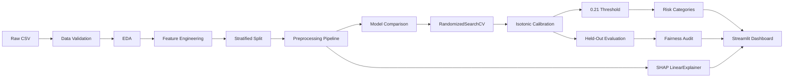

# Project Interview Guide

## A. Project introductions

### 30-second introduction

"I built an Employee Attrition Intelligence Platform that analyzes historical
workforce data, estimates attrition propensity, explains model associations with
SHAP, and provides a Streamlit dashboard. I used a reproducible 80/20 stratified
split, compared six classification approaches, tuned promising models using
training-only cross-validation, calibrated Logistic Regression with isotonic
calibration, and audited demographic performance. It is decision support, not an
automated employment decision system."

### 1-minute introduction

"The project began with a 1,470-record, 31-column employee attrition dataset. I
validated it, found 237 historical attrition records and 1,233 non-attrition
records, then completed EDA and reproducible preprocessing. I evaluated a dummy
baseline, Logistic Regression, Decision Tree, Random Forest, Gradient Boosting,
and XGBoost using five-fold stratified cross-validation. Logistic Regression
provided the best tuned training PR-AUC among the optimized candidates. I calibrated
its probabilities with isotonic calibration and evaluated it on a 294-record
held-out test set for the first time. The final result was PR-AUC 0.5654 and recall
0.5745. I added SHAP explanations, a 0.21 classification threshold, Low/Medium/High
risk categories, demographic fairness auditing, and a Streamlit dashboard."

### 2-minute detailed explanation

"The project is structured around a clear data-science workflow. First, I checked
the dataset for missing values, duplicates, target balance, data types, and
potential leakage. EDA showed that employees with overtime had 30.53% historical
attrition versus 10.44% without overtime, while the Sales Representative role had
the highest role-level observed attrition rate at 39.76%.

"Before modeling, I split the data 80/20 with stratification and embedded
feature engineering and preprocessing in a pipeline. The preprocessing median
imputes numeric fields, scales numeric fields, most-frequently imputes categorical
fields, and one-hot encodes categories. I excluded Attrition from inputs and kept
Age, Gender, and MaritalStatus separate for fairness auditing.

"I compared six models with five-fold cross-validation on the training partition.
The tuned Logistic Regression had the highest training PR-AUC and became the
candidate for final calibration. I selected isotonic calibration because it had a
lower training OOF Brier score than sigmoid calibration.

"The final held-out test result was PR-AUC 0.5654 and recall 0.5745. I use a 0.21
F1-score 0.5455. I use a 0.21 classification threshold and separate Low/Medium/High risk boundaries at 30% and
60%. SHAP explains the underlying Logistic Regression score, not the exact
isotonic probability transformation. The dashboard presents these results,
what-if scenarios, explainability, and demographic fairness metrics. The project
does not predict exact resignation dates."

### 5-minute technical walkthrough

1. Define the historical binary classification problem.
2. Demonstrate dataset validation: 1,470 rows, 31 columns, no missing or duplicate rows.
3. Explain EDA findings and class imbalance.
4. Describe feature engineering and sensitive-feature separation.
5. Explain the stratified 80/20 split and 1,176/294 partition.
6. Describe cross-validation and the six-model Phase 4 baseline.
7. Explain Phase 5 bounded randomized tuning.
8. Explain why PR-AUC and recall mattered more than accuracy alone.
9. Explain calibration and why isotonic was selected.
10. Explain the 0.21 threshold and the 30/60 risk category boundaries.
11. Present held-out metrics and confusion matrix.
12. Explain LinearExplainer SHAP and the calibration distinction.
13. Explain fairness findings and subgroup limitations.
14. Demonstrate the dashboard pages and hypothetical model output.
15. State limitations and responsible-use boundaries.

## B. Problem statement

Employee attrition means an employee ends their employment relationship. Organizations
care because replacement hiring, lost experience, team disruption, and workforce
planning can create operational and talent-management costs.

This project does not measure verified business ROI. It helps analysts understand
historical patterns and prepare transparent, reviewable attrition-propensity estimates.
Predictive analytics can support human-reviewed workforce research, but it should
not replace contextual HR judgment or make adverse decisions.

## C. End-to-end architecture

The held-out test set is used after training and tuning. Preprocessing is contained
inside pipelines and re-fitted within cross-validation folds.

## D. Dashboard walkthrough

1. **Executive Overview:** dataset KPIs, department distribution, historical attrition.
2. **Employee Risk Assessment:** hypothetical operational profile and calibrated propensity.
3. **Department Analytics:** department employee counts and held-out risk summaries.
4. **Workforce Insights:** overtime, role, tenure, satisfaction, and balance patterns.
5. **Explainability Center:** global importance, summary/bar charts, and individual examples.
6. **Fairness & Responsible AI:** Age, Gender, and MaritalStatus audit metrics.
7. **What-If Scenario Lab:** hypothetical baseline-versus-scenario model comparison.
8. **Model Performance:** held-out metrics, ROC, PR, confusion matrix, and calibration.

## E. Business value

Realistic applications include prioritizing voluntary conversations, understanding
department patterns, planning workforce reviews, documenting model limitations,
and identifying features for later external validation. The project does not
claim proven cost savings or ROI.

## F. Difficult interviewer questions

**Why did you select Logistic Regression?**  
It had the highest tuned training PR-AUC among the optimized candidates and was
compatible with linear SHAP. It was also interpretable and practical.

**Why isotonic calibration?**  
Training-only OOF Brier score was 0.088374 for isotonic versus 0.091281 for sigmoid.

**Why threshold 0.21?**  
Training OOF precision-recall trade-off used minimum recall 65%, then the highest
eligible F1.

**Why is PR-AUC important here?**  
The positive class is 16.12%, so PR-AUC is informative for minority-class detection.

**Why is held-out PR-AUC lower than cross-validation?**  
Cross-validation estimates training-fold performance, while held-out evaluation
uses a fixed independent test split.

**Why is this not a 30-day attrition prediction system?**  
The target has no verified 30/60/90-day outcome horizon.

**How did you prevent data leakage?**  
Test records were untouched, preprocessing was fit in training folds, and Attrition
was excluded from model inputs.

**Does SHAP explain the calibrated probability?**  
No exact calibrated-probability SHAP was implemented. SHAP explains the underlying
logistic score.

**How did you handle fairness?**  
Sensitive fields were excluded from operational inputs and used only for held-out
subgroup metrics.

**What would improve with more data?**  
External provenance, time-stamped outcomes, larger subgroups, proxy audits,
drift monitoring, and prospective evaluation.

**How would you deploy and monitor it?**  
Use Streamlit configuration, artifact integrity checks, probability and feature
drift monitoring, recalculated fairness metrics, and human review.

## G. Resume-ready description

**Professional title:** Employee Attrition Intelligence Platform

**Technology stack:** Python, Pandas, NumPy, Scikit-learn, XGBoost, SHAP,
Streamlit, Plotly, Joblib, pytest.

**ATS-friendly bullets**

- Built an end-to-end employee attrition platform using a 1,470-record stratified
  dataset, preprocessing, five-fold model comparison, and held-out evaluation.
- Implemented isotonic calibration, 0.21 classification threshold, and Low/
  Medium/High risk scoring.
- Integrated SHAP explanations and demographic fairness auditing while keeping
  Age, Gender, and MaritalStatus out of operational inputs.
- Developed an eight-page Streamlit dashboard with reproducible testing,
  logging, artifact validation, and deployment preparation.

**GitHub project description**

"An explainable employee attrition analytics platform combining Scikit-learn
modeling, isotonic calibration, SHAP, fairness auditing, and an eight-page
Streamlit dashboard."

## H. Self-assessment checklist

- [ ] Can explain data validation and class imbalance.
- [ ] Can explain the 80/20 split and five-fold cross-validation.
- [ ] Can explain PR-AUC and recall.
- [ ] Can defend the Logistic Regression selection.
- [ ] Can explain isotonic calibration.
- [ ] Can distinguish threshold 0.21 from 30/60 risk categories.
- [ ] Can explain SHAP and its calibration limitation.
- [ ] Can explain fairness metrics and limitations.
- [ ] Can demonstrate all eight dashboard pages.
- [ ] Can describe the project honestly as historical propensity analytics.

## I. Mock interview set

1. Give a 60-second project summary.
2. Why is Logistic Regression suitable for this project?
3. How did you prevent data leakage?
4. Which evaluation metric mattered most and why?
5. What changed after hyperparameter tuning?
6. Why was isotonic calibration selected?
7. How would you use the 0.21 threshold responsibly?
8. What does SHAP show and what does it not show?
9. Which demographic metric differences did you observe?
10. How would you monitor the project after deployment?
