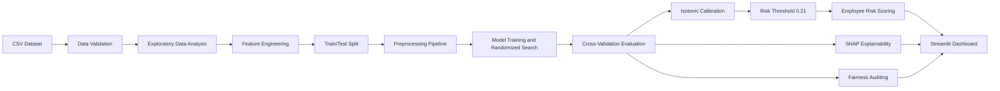

# Employee Attrition Intelligence Platform

An industry-oriented, end-to-end employee attrition analytics platform that combines
historical workforce analysis, stratified machine learning, calibrated risk scoring,
SHAP explainability, demographic fairness auditing, and an interactive Streamlit
dashboard.

> **Responsible-use notice:** This project estimates historical attrition propensity.
> It does not predict a verified 30-, 60-, or 90-day resignation event and must not
> automate termination, promotion, compensation, or opportunity decisions.

## Business Problem

Organizations can benefit from understanding historical patterns associated with
employee attrition. This project provides HR analysts with:

- an attrition probability estimate for analytical review;
- department and workforce-level historical comparisons;
- model explanations for reviewable, non-causal reason signals;
- subgroup performance analysis for responsible-AI review;
- hypothetical scenario exploration.

The supplied CSV is treated as a **company-inspired analytical case study**. It has
not been independently verified as actual Palo Alto Networks employee data.

## Key Capabilities

- Data validation and documented profiling
- Exploratory data analysis with 16 charts
- Business-oriented feature engineering
- Leakage-controlled preprocessing and stratified train/test split
- Baseline and tuned classification models
- Probability calibration and configurable thresholding
- Employee and department risk summaries
- SHAP-based global and individual explanations
- Age, Gender, and MaritalStatus fairness auditing
- Eight-page Streamlit dashboard
- Model, data, and artifact integrity checks

## Technology Stack

| Area | Technology |
|---|---|
| Language | Python |
| Data analysis | Pandas, NumPy, SciPy |
| Visualization | Matplotlib, Seaborn, Plotly |
| Machine learning | Scikit-learn, XGBoost |
| Explainability | SHAP |
| Dashboard | Streamlit |
| Model serialization | Joblib |
| Testing | pytest, unittest, Streamlit AppTest |
| Deployment configuration | Streamlit Community Cloud, Python 3.12 runtime |

The project also uses standard-library logging, pathlib, JSON, and CSV tools.

## Architecture



## Project Structure

```text
Employee-Attrition-Prediction/
├── app.py
├── app/
│   ├── components/
│   └── utils/
├── configs/
├── data/
│   ├── raw/
│   └── processed/
├── models/
│   ├── phase4/
│   ├── phase5/
│   └── phase6...
├── notebooks/
├── reports/
│   ├── figures/
│   └── explainability/
├── scripts/
├── src/
│   ├── analysis/
│   ├── config/
│   ├── data/
│   ├── explainability/
│   ├── fairness/
│   ├── features/
│   ├── models/
│   └── utils/
└── tests/
```

## Dataset

Actual supplied-data profile:

- **Records:** 1,470
- **Columns:** 31
- **Numeric columns:** 24
- **Categorical columns:** 7
- **Target:** `Attrition`
- **No attrition (`0`):** 1,233
- **Attrition (`1`):** 237
- **Historical attrition rate:** 16.12%
- **Missing cells:** 0
- **Duplicate rows:** 0

The target is moderately imbalanced at approximately a 5.20:1 majority/minority ratio.
The data may reflect historical organizational patterns and does not establish
provenance, causal relationships, or a future 30/60/90-day outcome horizon.

See [DATA_DICTIONARY.md](DATA_DICTIONARY.md) and
[reports/dataset_profile.md](reports/dataset_profile.md).

## Machine Learning Methodology

### Data preparation

- 80% training partition: 1,176 records
- 20% held-out test partition: 294 records
- Stratified splitting with random seed 42
- Median imputation and standard scaling for numeric features
- Most-frequent imputation and one-hot encoding for categorical features
- No SMOTE in the completed implementation
- Initial balanced class weights or equivalent model weighting

### Candidate models

The baseline comparison included:

- Dummy classifier
- Logistic regression
- Decision tree
- Random forest
- Histogram gradient boosting
- XGBoost

Phase 5 performed bounded randomized hyperparameter searches on the training
partition for the logistic regression, histogram gradient boosting, and XGBoost
candidates using five-fold stratified cross-validation.

### Final model

- Tuned Logistic Regression
- Isotonic calibration
- Classification threshold: **0.21**
- Low risk: probability below 30%
- Medium risk: 30% through 60%
- High risk: above 60%

The 0.21 value is a classification threshold. It is separate from the risk-category
boundaries.

## Verified Held-Out Test Performance

The following values were measured once on the 294-record held-out test set:

| Metric | Result |
|---|---:|
| Accuracy | 0.8469 |
| Precision | 0.5192 |
| Recall | 0.5745 |
| F1-score | 0.5455 |
| ROC-AUC | 0.8035 |
| PR-AUC | 0.5654 |
| Balanced accuracy | 0.7366 |
| Specificity | 0.8988 |
| Calibrated Brier score | 0.1015 |

Source: [reports/phase6_validation_metadata.json](reports/phase6_validation_metadata.json)
and [reports/test_model_validation.csv](reports/test_model_validation.csv).

## Explainable AI

SHAP uses `LinearExplainer` on the underlying fitted Logistic Regression score.
The generated explanation matrix is 294 × 50 transformed features.

Important distinction:

- SHAP explains the linear model score in log-odds-style contributions.
- SHAP does not directly explain the exact isotonic calibration mapping.
- Calibrated probabilities are reported separately.

The model excludes Age, Gender, and MaritalStatus from operational predictions and
explanation reasons.

See [reports/SHAP_EXPLAINABILITY_REPORT.md](reports/SHAP_EXPLAINABILITY_REPORT.md)
and [reports/XAI_METHODOLOGY.md](reports/XAI_METHODOLOGY.md).

## Fairness and Responsible AI

The held-out audit evaluated:

- Age bands: 18–30, 31–40, 41–50, 51+
- Gender
- MaritalStatus

Notable audit outputs include:

- Age demographic parity difference: 0.2143
- Age equal-opportunity difference: 0.5000
- Gender demographic parity difference: 0.0211
- Gender equal-opportunity difference: 0.1714
- MaritalStatus demographic parity difference: 0.2361
- MaritalStatus equal-opportunity difference: 0.2500

These are descriptive held-out differences, not proof of discrimination.
Small subgroup sizes and historical-data bias limit conclusions.

See [reports/FAIRNESS_AUDIT_REPORT.md](reports/FAIRNESS_AUDIT_REPORT.md),
[reports/RESPONSIBLE_AI_GUIDELINES.md](reports/RESPONSIBLE_AI_GUIDELINES.md),
and [RESPONSIBLE_AI.md](RESPONSIBLE_AI.md).

## Streamlit Dashboard

The dashboard has eight pages:

1. **Executive Overview** — historical and projected-risk KPIs
2. **Employee Risk Assessment** — hypothetical calibrated risk assessment
3. **Department Analytics** — department employee and attrition comparisons
4. **Workforce Insights** — overtime, satisfaction, tenure, and role patterns
5. **Explainability Center** — global and individual SHAP outputs
6. **Fairness & Responsible AI** — demographic metrics and guidelines
7. **What-If Scenario Lab** — hypothetical model output comparisons
8. **Model Performance** — held-out metrics and calibration plots

No verified dashboard screenshots are currently available, so README presentation
does not include fabricated screenshots.

## Installation and Local Execution

Create or activate the existing virtual environment:

```powershell
cd D:\Desktop\Employee-Attrition-Prediction
.\\.venv\Scripts\Activate.ps1
python -m pip install -r requirements.txt
```

Launch the dashboard:

```powershell
python -m streamlit run app.py
```

Run profiling and tests:

```powershell
python scripts/profile_dataset.py
python scripts/run_phase8.py
python scripts/verify_artifacts.py
python scripts/run_phase11_quality.py
python -m pytest tests -q
python -m unittest discover -s tests -p "test_*.py" -q
```

Deployment preparation uses Python 3.12.10 in `runtime.txt`. Deployment
instructions are in [DEPLOYMENT_GUIDE.md](DEPLOYMENT_GUIDE.md).
No public URL is claimed because no authenticated public deployment was verified.

## Testing

The verified test suites are:

- **pytest:** 64 tests passed
- **unittest:** 18 tests passed

The unittest suite is a separate runner and overlapping pytest tests are not
counted as additional tests. Streamlit AppTest is included in pytest coverage.

See [reports/TEST_EXECUTION_REPORT.md](reports/TEST_EXECUTION_REPORT.md) and
[TESTING_STRATEGY.md](TESTING_STRATEGY.md).

## Documentation

- [PROJECT_OVERVIEW.md](PROJECT_OVERVIEW.md)
- [METHODOLOGY.md](METHODOLOGY.md)
- [DATA_DICTIONARY.md](DATA_DICTIONARY.md)
- [MODEL_CARD.md](MODEL_CARD.md)
- [RESPONSIBLE_AI.md](RESPONSIBLE_AI.md)
- [EMPLOYEE_ATTRITION_RESEARCH_PAPER.md](EMPLOYEE_ATTRITION_RESEARCH_PAPER.md)
- [EXECUTIVE_SUMMARY.md](EXECUTIVE_SUMMARY.md)
- [PROJECT_INTERVIEW_GUIDE.md](PROJECT_INTERVIEW_GUIDE.md)
- [TECHNICAL_INTERVIEW_QA.md](TECHNICAL_INTERVIEW_QA.md)
- [BUSINESS_CASE_STUDY.md](BUSINESS_CASE_STUDY.md)
- [PROJECT_WALKTHROUGH.md](PROJECT_WALKTHROUGH.md)
- [FINAL_PROJECT_AUDIT.md](FINAL_PROJECT_AUDIT.md)
- [TESTING_STRATEGY.md](TESTING_STRATEGY.md)
- [DEPLOYMENT_GUIDE.md](DEPLOYMENT_GUIDE.md)
- [reports/QUALITY_ASSURANCE_REPORT.md](reports/QUALITY_ASSURANCE_REPORT.md)

## Limitations and Future Improvements

- The dataset does not contain an actual resignation timing outcome.
- EDA associations do not prove causation.
- SHAP does not exactly explain isotonic calibration.
- Held-out subgroup sizes are limited.
- Protected attributes are not operational model inputs.
- External validation and future data monitoring are required.
- A deployment URL is pending GitHub/Streamlit account access.

## GitHub Topics

`employee-attrition`, `machine-learning`, `hr-analytics`, `streamlit`,
`explainable-ai`, `shap`, `scikit-learn`, `fairness`, `responsible-ai`,
`mlops`
